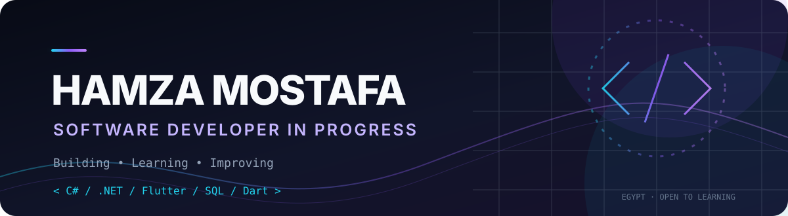

<div align="center">



<br/>

[](https://github.com/marwanhazem12789-lgtm)
[](https://github.com/marwanhazem12789-lgtm)
[](https://www.google.com/maps)

<br/>

<a href="#about-me">About</a> •
<a href="#tech-stack">Tech Stack</a> •
<a href="#what-im-building">What I'm Building</a> •
<a href="#github-activity">Activity</a> •
<a href="#connect">Connect</a>

</div>

---

## `01` — About Me

```yaml
name: Hamza Mostafa
role: Aspiring Software Developer
education: Computer Science & AI / Programming track
location: Egypt
currently_learning:
  - Backend Development with C# and ASP.NET Core
  - Flutter & Dart
  - SQL and database design
interests:
  - Building useful applications
  - Clean code and problem solving
  - Exploring software architecture
```

I'm a programming student who enjoys turning ideas into practical applications.  
I'm currently growing my skills across **backend development** and **mobile app development**, learning by building projects and improving them step by step.

- 🔭 Working on backend and task-management projects.
- 🌱 Learning more about **ASP.NET Core, Flutter, REST APIs, and SQL**.
- 🧩 Interested in application architecture, APIs, and database-driven systems.
- 🎯 Goal: become a well-rounded software developer and build products that solve real problems.

---

## `02` — Tech Stack

<div align="center">

### Languages


### Frameworks & Tools


### Databases


</div>

**Currently focusing on:** C# • ASP.NET Core • Flutter • Dart • SQL • REST APIs • Git

---

## `03` — What I'm Building

<table>
  <tr>
    <td width="50%">
      <h3>🗂️ Centralized Task Management System</h3>
      <p>A team project focused on organizing tasks and workflows in one place. Exploring requirements, application structure, and how users collaborate around tasks.</p>
      <sub>Focus: System analysis · Project planning · Software design</sub>
    </td>
    <td width="50%">
      <h3>👥 Company Employee API</h3>
      <p>A C# / ASP.NET Core case study for managing employees, departments, and projects through a structured API and repository-based data access.</p>
      <sub>Focus: ASP.NET Core · Entity Framework Core · SQL · DTOs</sub>
    </td>
  </tr>
  <tr>
    <td width="50%">
      <h3>📱 Flutter API Practice</h3>
      <p>Learning to connect Flutter applications to REST APIs, handle responses with Dio, and build login, signup, and user-list interfaces.</p>
      <sub>Focus: Flutter · Dart · Dio · REST APIs</sub>
    </td>
    <td width="50%">
      <h3>🧪 Learning Projects</h3>
      <p>Small experiments and exercises that help me understand programming fundamentals, UI development, data handling, and clean project structure.</p>
      <sub>Focus: Consistent practice · Problem solving · Improvement</sub>
    </td>
  </tr>
</table>

---

## `04` — GitHub Activity

<div align="center">


<br/>


<br/>


</div>

---

## `05` — Beyond the Code

I believe good development comes from curiosity, consistency, teamwork, and communication.  
I enjoy taking part in school initiatives, collaborating with others, and learning how to turn an idea into something people can actually use.

---

## `06` — Connect

<div align="center">

<a href="https://github.com/marwanhazem12789-lgtm">
  
</a>

<br/><br/>

<sub>Thanks for stopping by. Feel free to explore my repositories and follow my learning journey.</sub>

<br/>


</div>
